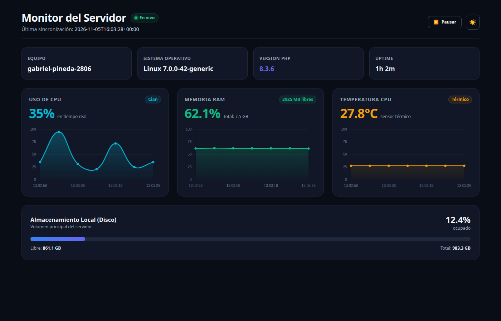
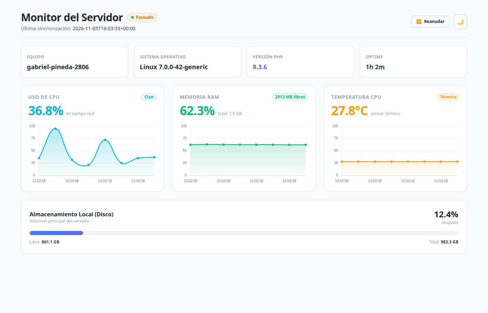
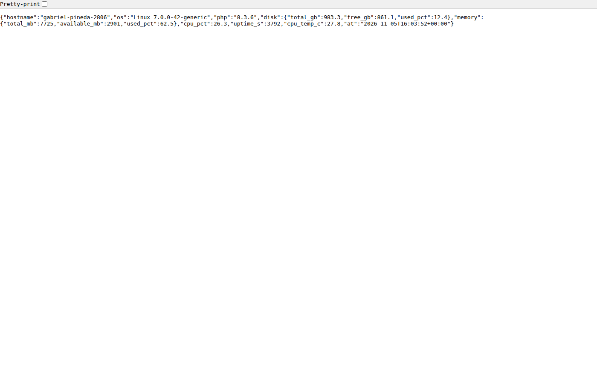

# Trabajo Práctico: Monitor del Servidor con Laravel

**Universidad Tecnológica Nacional – Facultad Regional Resistencia (UTN FRRe)**  
**Tecnicatura Universitaria en Programación (TUP)**  
**Cátedra:** Programación IV (Cuarto Cuatrimestre - Cohorte 2026)  
**Docente:** Fernando Aguirre  
**Estudiante:** Gabriel Pineda  
**Repositorio GitHub:** [https://github.com/Gabiota2806/laravel-server-monitor](https://github.com/Gabiota2806/laravel-server-monitor)  
**Documento Editable en Google Docs:** [https://docs.google.com/document/d/1BKxE7kAuTtmeiKgp5s8E5N2GAmC3tFbmdHbgY9o5Lw0/edit](https://docs.google.com/document/d/1BKxE7kAuTtmeiKgp5s8E5N2GAmC3tFbmdHbgY9o5Lw0/edit)  

---

## 1. Entorno de Ejecución y Tecnologías

- **Sistema Operativo:** Linux Mint (Base Ubuntu 24.04 LTS / Kernel Linux 7.0 generic x86_64).
- **Backend:** PHP 8.3.6 con framework Laravel 13.x.
- **Frontend:** Laravel Blade, Tailwind CSS y Chart.js para visualización de series temporales en tiempo real.
- **Arquitectura de Métricas:** Soporte multiplataforma mediante clase de servicio `ServerMetrics` con lectura directa desde el subsistema virtual `/proc` y `/sys` en Linux y WMI/PowerShell en Windows.

---

## 2. Dashboard de Monitoreo en Tiempo Real (Modo Oscuro)

### Explicación Técnica de la Interfaz:
- **Tarjetas de Identidad del Sistema:** Encabezado con información estática del host (nombre de máquina, versión de kernel y sistema operativo, versión de PHP en ejecución y contador de tiempo activo transcurrido formateado en días, horas y minutos).
- **Gráficos de Líneas Dinámicos (Chart.js):**
  - **Uso de CPU (%):** Representación gráfica de la actividad del procesador mediante el cálculo diferencial de ticks de reloj entre intervalos en `/proc/stat`. Se renderiza con una curva Bézier suave y relleno degradado en color cian.
  - **Memoria RAM (%):** Medición de memoria utilizada frente a memoria total y disponible extraída de `/proc/meminfo`, renderizada en verde esmeralda.
  - **Temperatura de CPU (°C):** Lectura directa de sensores térmicos del hardware (`/sys/class/thermal/thermal_zone0/temp`), graficada con alerta cromática en tonos ámbar.
- **Buffer Deslizante en Memoria:** Los gráficos conservan una ventana temporal móvil de las últimas 20 muestras en memoria del cliente (aproximadamente 1.5 a 2 minutos de monitoreo continuo) sin generar sobrecarga de I/O en la base de datos del servidor.
- **Almacenamiento Local:** Barra de progreso visual con desglose exacto de gigabytes ocupados y libres calculados con `disk_total_space()` y `disk_free_space()`.

---

## 3. Controles Interactivos y Modo Claro

### Explicación de los Controles:
- **Pausa / Reanudación del Monitoreo:** Permite al operador detener temporalmente las peticiones asíncronas (`fetch`) hacia el servidor. Al pausar, el indicador visual de pulso cambia a estado ambar "Pausado", evitando el consumo innecesario de recursos de red y CPU cuando el monitoreo no es requerido de forma activa.
- **Alternancia de Tema (Modo Claro / Modo Oscuro):** Implementación de diseño responsivo que adapta dinámicamente los contrastes, tarjetas, bordes y ejes de los gráficos para una visualización óptima bajo diferentes condiciones de luminosidad ambiental.

---

## 4. Endpoint de API REST JSON (`/api/metrics`)

### Explicación del Endpoint:
- **Ruta:** `GET /api/metrics`
- **Formato:** JSON estructurado (`Content-Type: application/json`).
- **Controlador:** `ServerController@api`, consumiendo la inyección de dependencias de `ServerMetrics`.
- **Seguridad y Rate Limiting:** La ruta se encuentra protegida con el middleware `throttle:60,1`, limitando la tasa de peticiones a un máximo de 60 solicitudes por minuto por dirección IP para prevenir ataques de denegación de servicio (DoS) o bucles infinitos en clientes.

---

## 5. Respuestas a las Preguntas de Evaluación

### Pregunta 1: ¿Por qué la temperatura suele aparecer como "No disponible" en Windows?
En entornos Windows, la consulta WMI para la temperatura utiliza el espacio de nombres `root/wmi` y la clase `MSAcpi_ThermalZoneTemperature`. Esta interfaz requiere privilegios de Administrador para ser leída por motivos de seguridad; una terminal o servidor web sin elevación de permisos recibe un error de acceso denegado (`Access Denied`). Además, en muchas placas madre de escritorio actuales los fabricantes no exponen la interfaz estándar ACPI a WMI genérico, requiriendo software propietario de monitoreo.

### Pregunta 2: ¿Por qué el script de PowerShell nunca debe incluir datos que vengan del usuario?
Porque provocaría una vulnerabilidad crítica de Inyección de Comandos (Command Injection / Arbitrary Code Execution). Si un parámetro enviado por el cliente mediante query params, formularios o cabeceras fuese concatenado directamente en el script ejecutado por `shell_exec()`, un atacante podría enviar operadores de encadenamiento (como `;`, `|`, `&&`) y ejecutar código malicioso arbitrario con los privilegios del proceso del servidor web.

### Pregunta 3: ¿Qué riesgo tiene dejar `/api/metrics` sin autenticación en un servidor real?
Existen dos riesgos fundamentales:
1. **Fuga de Información de Infraestructura (Reconnaissance):** Revela versiones exactas de software (PHP, kernel), arquitectura del servidor y patrones de actividad de recursos, lo que permite a atacantes identificar vulnerabilidades conocidas (CVEs) con precisión.
2. **Denegación de Servicio (DoS):** Si múltiples clientes o bots bombardean el endpoint con peticiones concurrentes, el cálculo continuo de métricas en tiempo real saturará la CPU y la memoria del servidor, degradando el servicio para los usuarios legítimos.

### Pregunta 4: Con polling cada 5 segundos, ¿cuántos pedidos por minuto recibe el servidor si hay 50 personas mirando?
- 1 usuario realiza 1 pedido cada 5 segundos = 12 pedidos por minuto (60 / 5 = 12).
- Con 50 personas concurrentes: 50 * 12 = 600 peticiones por minuto (es decir, una tasa sostenida de 10 peticiones por segundo).
Esto expone la ineficiencia del polling HTTP tradicional ante un número creciente de clientes, fundamentando el uso de WebSockets (como Laravel Reverb) para arquitecturas en tiempo real eficientes.

### Pregunta 5: Si una app solo necesita la temperatura, ¿qué datos recibe de más al llamar a `/api/metrics`?
Recibe innecesariamente el nombre de host, sistema operativo, versión de PHP, estadísticas completas de disco, memoria y tiempo de encendido (uptime). En diseño de interfaces de programación, este exceso de datos no requeridos se denomina Over-fetching, problemática que herramientas como GraphQL resuelven permitiendo al cliente solicitar de forma declarativa solo los campos que precisa.
